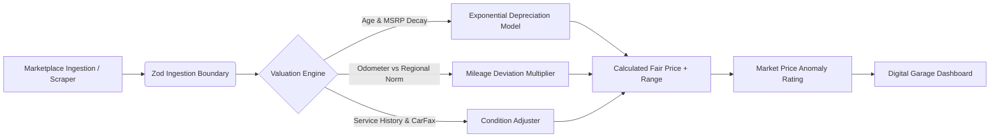

<div align="center">

# 🏎️ AvtoNet Garage

**Intelligent Automotive Marketplace Aggregator & Algorithmic Valuation Platform**

[](https://github.com/flegartech-mvp/avtonet-garage/actions)
[](https://www.typescriptlang.org/)
[](https://opensource.org/licenses/MIT)
[](https://vitest.dev/)
[](https://github.com/flegartech-mvp/avtonet-garage)

[**Live Demo**](https://garage.flegartech.com) • [**API Documentation**](https://docs.garage.flegartech.com) • [**Report Bug**](https://github.com/flegartech-mvp/avtonet-garage/issues)

</div>

---

## 📌 Executive Summary

**AvtoNet Garage** is an enterprise-clean automotive marketplace aggregator, algorithmic fair-price calculator, and digital garage maintenance platform. Designed to eliminate price asymmetry in used-car transactions, the system models multi-variable depreciation curves factoring in vehicle age, annual mileage deviation, service completeness, and structural repair history.

---

## 🎯 Target Persona & Real-World Use Cases

- **Car Buyers & Deal Hunters:** Instantly flag undervalued bargains and overpriced listings before contacting sellers.
- **Vehicle Owners & Enthusiasts:** Track real-time digital garage equity, monthly depreciation bleed, and upcoming scheduled service milestones.
- **Used Car Dealers & Appraisers:** Benchmark inventory against historical actuarial depreciation curves.

---

## 🚀 Live Demo & Interactive Preview

| Algorithmic Fair Value Analyzer | Digital Garage & Maintenance |
| :---: | :---: |
| [](https://garage.flegartech.com) | [▶ Launch Valuation Sandbox](https://garage.flegartech.com/appraiser) |

---

## ⚡ Key Engineering Highlights

- **Multi-Factor Depreciation Models:** Exponential decay curve with year-1 steep depreciation and continuous secondary decay with mileage sensitivity.
- **Price Anomaly Detector:** Automated classification into `OUTSTANDING_VALUE`, `FAIR_MARKET_PRICE`, `SLIGHTLY_ELEVATED`, and `OVERPRICED`.
- **Comparative Spec Matrix:** Head-to-head performance, power-to-weight, and total cost of ownership (TCO) evaluation.
- **Strict TypeScript & Zod:** Zero untyped payload assumptions for scraping inputs, automotive specifications, and service log structures.

---

## 🏗️ System Architecture & Data Pipeline



---

## 🛠️ Quickstart & Local Development

### Prerequisites
- Node.js `20.x` or higher
- `pnpm` `9.x` (recommended) or `npm`

### Installation & Execution

```bash
# 1. Clone the repository
git clone https://github.com/flegartech-mvp/avtonet-garage.git
cd avtonet-garage

# 2. Install dependencies
pnpm install

# 3. Configure environment variables
cp .env.example .env

# 4. Start local development server
pnpm dev

# 5. Run automated test suite
pnpm test

# 6. Typecheck & linting verification
pnpm typecheck
```

---

## 🧪 Testing & Quality Assurance

```bash
pnpm test:coverage
```

Our Vitest test suite verifies:
- Multi-year depreciation mathematical boundaries
- Mileage penalty / reward scaling
- Service record history value preservation
- Zod schema validation against invalid vehicle parameters

---

## 📄 License & Contributing

Distributed under the **MIT License**. Contributions and marketplace integrations are welcome!
