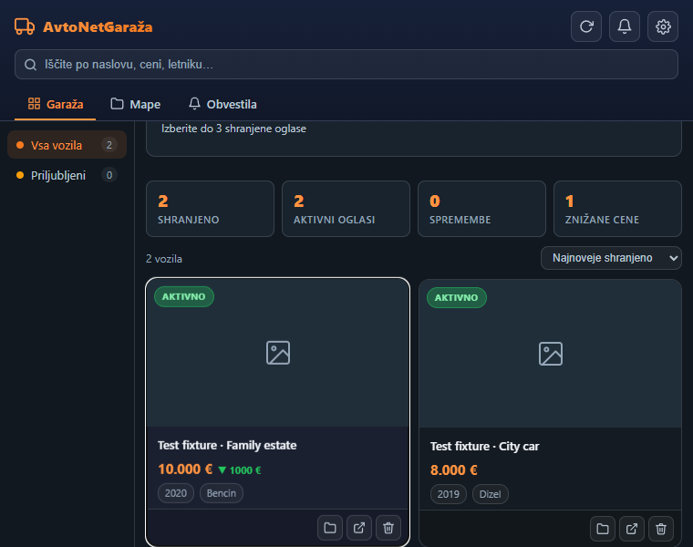
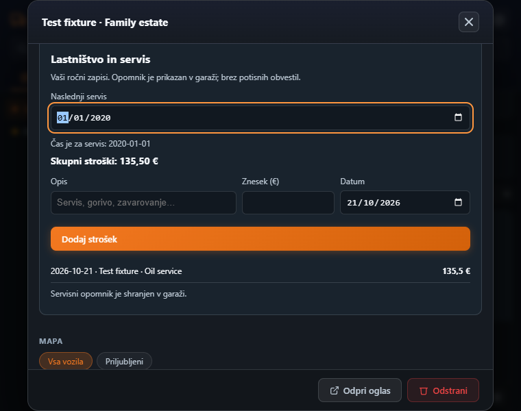

# AvtoNetGaraža

Save avto.net listings, organize folders, follow price/status changes, compare saved vehicles, and record ownership expenses and the next service date.

[Chrome Web Store](https://chromewebstore.google.com/detail/fgpcanlkfjelbccblfpgmobgfmahpiia) · [Repository](https://github.com/flegardev/Avtonet-garage)

## Release status

Candidate **1.1.0**; previous version **1.0.4** confirmed from the actual Google update-service package. Upload/submission/publication have not occurred. See [release notes](CHANGELOG.md).

The complete extension is in **`extension/`**. The TypeScript modules in `src/` are retained separately and are not the extension entry point. Full historical source was recovered from PR #1, rather than replacing the product with the incomplete module library.

## Development

Use Node.js 24 and npm.

```sh
cd extension
npm ci
npm run validate
npx playwright install chromium
npm run test:extension
npm run package
```

## Load unpacked

Build first, then choose `extension/dist` in Chrome → Extensions → Developer mode → Load unpacked. Test with a separate profile. Production upgrades must go to the existing Store item; a different unpacked path can have a different extension ID.

## Architecture and data

Webpack bundles React popup, content scripts and the MV3 monitoring worker. parse5 parses listing HTML without browser DOM globals. Cross-context Web Locks serialize garage updates. Published `ag_vehicles`, `ag_folders`, `ag_settings` and `ag_notifications` keys are retained; ownership uses a new `ag_ownership` key and is included in export.

## Privacy and permissions

Runtime permissions are unchanged from the recovered published manifest. No analytics backend or remote executable code is added. See [privacy policy](extension/PRIVACY.md). Exports contain private local records; share them only intentionally.

## Limitations

The local heuristic advisor is an estimate, not a market valuation or inspection. Monitoring depends on avto.net markup and availability. A service reminder appears in the garage, without push notifications. No new marketplace integration or maintenance provider is implied.

## Verification

Automated tests cover actual extension registration, real Chrome storage, legacy-shaped records, restart persistence, user controls and error states. UI fixtures use synthetic, visibly identified sample records. They do not represent the developer’s browsing activity or real car offers. Full live-site playback and all marketplace variants remain manual release checks. Store review/publication are separate from green CI.

## Screenshots

Test fixtures only; these screenshots do not represent real user activity.




